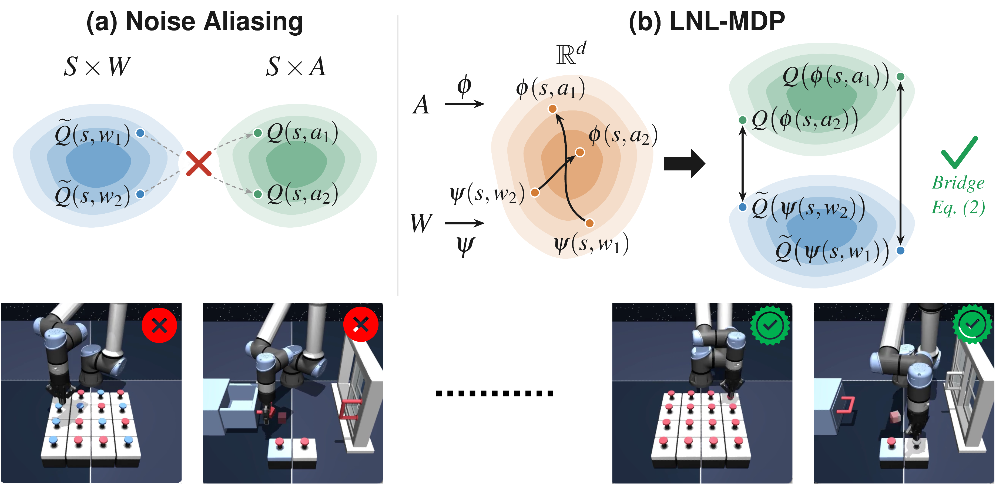

<div align="center">

<div id="user-content-toc" style="margin-bottom: 50px">
  <ul align="center" style="list-style: none;">
    <summary>
      <h1>Efficient Diffusion Policy Fine Tuning with Latent Noise Representation Bridging</h1>
      <br>
      <!-- <h2><a href="https://arxiv.org/abs/2502.02538">Paper</a> &emsp; <a href="https://seohong.me/projects/fql/">Project page</a></h2> -->
    </summary>
  </ul>
</div>



</div>

## Overview

Latent Representation Bridging for Diffusion (LARBRID) is a simple algorithm derived from the Latent Noise Linear MDP (LNL-MDP) framework. The framework solves the commonly encountered noise aliasing problem by aligning the action and noise representations. The combined effect of removing noise aliasing and learning a powerful representation makes LARBRID excel at fine-tuning diffusion and flow policies.

## Installation
For a fair comparison, our experiments are built around existing online and offline baselines separately. Make sure you run each experiment under the corresponding sub-directory, as the online and offline experiments do not mix. First, clone the entire repository:
```
git clone https://github.com/YC-Liang/LARBRID
cd LARBRID
```

### Online (Robomimic, Gymnasium)
Online experiments are built on top of PyTorch.

1. Navigate to the online directory
```bash
cd online
```

2. Create a conda environment
```bash
conda create -n larbrid python=3.10 -y
conda activate larbrid
```

3. Install our copy of DPPO 
```bash
cd dppo
pip install -e .
pip install -e .[robomimic]
pip install -e .[gym]
cd ..
```

4. Install our copy of Stable Baselines3
```bash
cd stable-baselines3
pip install -e .
cd ..
```

We reuse the same checkpoints as DSRL and DPPO for the Robomimic and Gym experiments, which can be found [here](https://drive.google.com/drive/folders/1kzC49RRFOE7aTnJh_7OvJ1K5XaDmtuh1?usp=share_link). Download the contents of this folder and place them in `./online/dppo/log`.

### Offline (OGBench)
Offline experiments require Python 3.11+ and are based on JAX. The main dependencies are
`jax >= 0.4.26`, `ogbench == 1.1.0`, and `gymnasium == 0.29.1`.

1. Navigate to the offline directory
```bash
cd offline
```

2. Create a separate conda environment
```bash
conda create -n larbrid-i python=3.12 -y
conda activate larbrid-i
```

3. Install the corresponding packages
```bash
pip install -r requirements.txt
```

## Running LARBRID Online Fine-Tuning
Navigate to `./online/` and activate the `larbrid` environment. Example runs are given below.

To run LARBRID on Robomimic, call
```bash
python train.py --config-path=cfg/robomimic --config-name=larbrid_can.yaml
```
where `larbrid_can.yaml` can be replaced by the config file of the desired task. Similarly, for Gym, call
```bash
python train.py --config-path=cfg/gym --config-name=larbrid_hopper.yaml
```
where `larbrid_hopper.yaml` can be replaced by the config file of the desired task.

## Running LARBRID-I Offline Fine-Tuning
Navigate to `./offline/` and activate the `larbrid-i` environment. Example runs are given below.

To run LARBRID-I (`larbrid_i`) for offline fine-tuning,
```bash
python main.py --agent=agents/larbrid_i.py --env_name=antmaze-large-navigate-singletask-v0 --agent.discount=0.99 --agent.alpha=10

python main.py --agent=agents/larbrid_i.py --env_name=antsoccer-arena-navigate-singletask-v0 --agent.discount=0.995 --agent.alpha=10

python main.py --agent=agents/larbrid_i.py --env_name=humanoidmaze-medium-navigate-singletask-v0 --agent.discount=0.995 --agent.alpha=30

python main.py --agent=agents/larbrid_i.py --env_name=cube-single-play-singletask-v0 --agent.discount=0.99 --agent.alpha=300
```

To run LARBRID-O2O (`larbrid_o2o`) for offline-to-online fine-tuning, first train the behaviour cloning flow policy as described below, since it is loaded as the frozen prior from `exp/bcf/<env_name>/`:
```bash
python main.py --agent=agents/larbrid_o2o.py --env_name=antmaze-large-navigate-singletask-v0 --offline_steps=0 --online_steps=1000000 --agent.discount=0.99 --balanced_sampling=1

python main.py --agent=agents/larbrid_o2o.py --env_name=antsoccer-arena-navigate-singletask-v0 --offline_steps=0 --online_steps=1000000 --agent.discount=0.995 --balanced_sampling=1

python main.py --agent=agents/larbrid_o2o.py --env_name=humanoidmaze-medium-navigate-singletask-v0 --offline_steps=0 --online_steps=1000000 --agent.discount=0.995 --balanced_sampling=1

python main.py --agent=agents/larbrid_o2o.py --env_name=scene-play-singletask-v0 --offline_steps=0 --online_steps=1000000 --agent.discount=0.995 --balanced_sampling=1

python main.py --agent=agents/larbrid_o2o.py --env_name=cube-double-play-singletask-v0 --offline_steps=0 --online_steps=1000000 --agent.discount=0.99 --balanced_sampling=1
```

To run LARBRID-I on visual observations,
```bash
python main.py --agent=agents/larbrid_i_img.py --env_name=visual-cube-single-play-singletask-task1-v0 --offline_steps=500000 --agent.alpha=300 --frame_stack=3
```

To run LARBRID (`larbrid`) for offline fine-tuning of a frozen flow policy, first train the behaviour cloning flow policy,
```bash
python main.py --agent=agents/bcf.py --env_name=antmaze-large-navigate-singletask-v0
```

Then run LARBRID, which fine-tunes the frozen flow model:
```bash
python main.py --agent=agents/larbrid.py --env_name=antmaze-large-navigate-singletask-v0 --agent.discount=0.99
```

## Practical Advice
LARBRID and LARBRID-I are both based on the LNL-MDP, a general and flexible framework that is independent of the specific problem, the diffusion or flow policy, and the fine-tuning algorithm. We therefore believe the technique can be applied to many future settings by simply:
1. Learning the corresponding representation of the problem,
2. Aligning the noise representation with the action representation,
3. Applying any RL fine-tuning technique conditioned on the representation (e.g. DSRL, FQL).

### LARBRID-Specific Hyperparameters
Setting the latent representation embedding dimension to 512 works well on most tasks, including those with image observations. The residual blocks inside the representation networks are usually 3 to 4 layers deep. For image observations, we found it important to encode each image into an individual embedding (with dimension 128) and concatenate these embeddings to form the latent state for representation learning. An image reconstruction loss is needed to ensure the encoded embedding retains as much of the original information as possible, and a window size of 3 keeps the aggregated latent state transitions close to Markovian.

### Other Hyperparameters
We found it sufficient to use the same hyperparameters as the original fine-tuning algorithms that LARBRID is built on. For instance, we use the same shared hyperparameters as DSRL (e.g. UTD, action magnitude) and FQL (e.g. alpha coefficient).

## Acknowledgements
To ensure fair and consistent training, we implement the online fine-tuning pipelines on top of [DSRL](https://github.com/ajwagen/dsrl), [DPPO](https://github.com/irom-princeton/dppo) and [Stable Baselines3](https://github.com/DLR-RM/stable-baselines3). The offline fine-tuning pipelines are built on top of [FQL](https://github.com/seohongpark/fql/tree/master). We use the official benchmark packages, including [Gymnasium](https://gymnasium.farama.org/index.html), [Robomimic](https://robomimic.github.io/) and [OGBench](https://github.com/seohongpark/ogbench).

## Citation
```
@article{liang2026larbrid,
  author    = {Liang, Yuanchu and Yang, Yue and He, An-Chi and Kurniawati, Hanna},
  title     = {Efficient Diffusion Policy Fine Tuning with Latent Noise Representation Bridging},
  journal   = {Conference on Neural Information Processing Systems (NeurIPS)},
  year      = {2026},
}
```
